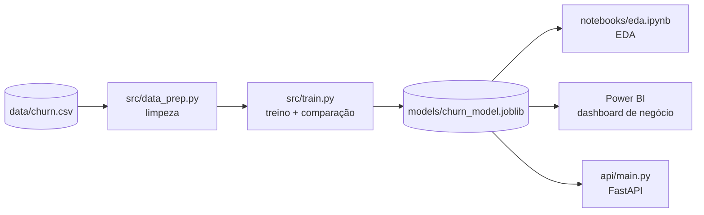

# Previsão de Churn de Clientes


Projeto end-to-end de Machine Learning para prever cancelamento de
clientes (churn) num cenário de telecom — do dado bruto a uma API
servindo previsões em tempo real, passando por limpeza, engenharia de
features, comparação de modelos, um notebook de análise exploratória e um
dashboard de negócio no Power BI.


## O problema

Prever churn é um dos casos de uso mais comuns em análise de dados e IA
aplicada a negócio: identificar clientes com risco de cancelamento permite
que a empresa aja antes (desconto, contato, upgrade de plano) em vez de só
reagir depois que o cliente já saiu.

## Arquitetura



O modelo treinado é o núcleo do projeto: o mesmo artefato (`.joblib`)
alimenta a análise exploratória, o dashboard e a API — sem duplicar lógica
de scoring entre eles (`score_customers()` em
[`src/export_for_bi.py`](src/export_for_bi.py) é reaproveitada tanto pelo
script de exportação quanto pelo endpoint `/generate-report`).

## Tecnologias

`Python` · `pandas` / `numpy` · `scikit-learn` · `FastAPI` + `uvicorn` ·
`pytest` · `Jupyter` (`matplotlib` / `seaborn`) · `Power BI`

## API

Endpoints em [`api/main.py`](api/main.py), com testes automatizados em
[`tests/test_api.py`](tests/test_api.py) (100% passando):

| Método | Rota              | Descrição                                              |
|--------|-------------------|---------------------------------------------------------|
| GET    | `/health`         | healthcheck                                              |
| POST   | `/predict`        | recebe os dados de 1 cliente, retorna previsão + probabilidade |
| POST   | `/generate-report`| roda o scoring em todos os clientes e atualiza `data/churn_scored.csv` |

```bash
uvicorn api.main:app --reload
# depois, abra http://127.0.0.1:8000/docs
```

## Sobre os dados

O dataset (`data/churn.csv`) é **sintético**, gerado por
[`data/generate_data.py`](data/generate_data.py) com semente fixa
(reprodutível), mas construído para imitar as correlações de um cenário
real de churn de telecom (baseado no conhecido dataset público *Telco
Customer Churn*):

- Contratos mês a mês têm risco de churn muito maior que contratos de 2 anos.
- Falta de suporte técnico e muitas ligações de suporte aumentam o risco.
- Tempo de casa (`tenure_months`) alto reduz o risco.
- O dataset tem valores faltantes e duplicatas propositais, para exercitar
  a etapa de limpeza.

Isso mantém o projeto 100% reprodutível offline, sem depender de download
de um dataset externo. Trocar por um dataset real (ex: Kaggle Telco
Customer Churn) é possível sem mudar o pipeline — só ajustar as colunas em
[`src/data_prep.py`](src/data_prep.py).

## Abordagem de Machine Learning

- **Pré-processamento**: `StandardScaler` nas features numéricas e
  `OneHotEncoder` nas categóricas, dentro de um `ColumnTransformer` (sem
  vazamento de dados entre treino/teste).
- **Modelos comparados**: Regressão Logística e Random Forest, ambos dentro
  de um `Pipeline` do scikit-learn.
- **Métricas**: accuracy, precision, recall, F1 e ROC-AUC — não só
  accuracy, já que o problema é moderadamente desbalanceado (~32% churn).
- **Seleção do modelo**: o modelo com maior ROC-AUC no conjunto de teste é
  salvo em `models/churn_model.joblib`.

### Resultados (dataset sintético atual)

| Modelo              | Accuracy | Precision | Recall | F1   | ROC-AUC |
|----------------------|----------|-----------|--------|------|---------|
| Regressão Logística  | 0.758    | 0.639     | 0.563  | 0.598| 0.804   |
| Random Forest         | 0.737    | 0.618     | 0.464  | 0.530| 0.781   |

A Regressão Logística venceu neste caso — sinal de que a relação entre as
features e o churn é majoritariamente linear no dataset gerado. Com um
dataset real, vale testar também Gradient Boosting (XGBoost/LightGBM).

## Análise Exploratória (EDA)

Notebook guiado ([`notebooks/eda.ipynb`](notebooks/eda.ipynb), roteiro
completo em [`TASK_EDA.md`](TASK_EDA.md)) cobrindo distribuições,
correlações e taxa de churn por segmento.

## Dashboard no Power BI

Os dados com a previsão do modelo incluída
(`data/churn_scored.csv`, gerado por `src/export_for_bi.py` ou pelo
endpoint `/generate-report`) alimentam um dashboard de negócio com KPIs,
gráficos por segmento e uma tabela de clientes de maior risco. Roteiro
completo em [`TASK_POWERBI.md`](TASK_POWERBI.md).

## Como rodar

```bash
python -m venv .venv
.venv\Scripts\activate            # Windows
pip install -r requirements.txt

python data/generate_data.py       # gera data/churn.csv
pytest -v                           # roda toda a suite de testes
python -m src.train                  # treina, compara modelos e salva o melhor
python -m src.predict data/churn.csv  # exemplo de predição em lote
uvicorn api.main:app --reload          # sobe a API em http://127.0.0.1:8000/docs
```

## Estrutura do projeto

```
data/generate_data.py     # gera o dataset sintético (data/churn.csv)
src/data_prep.py           # limpeza e preparação (funções puras, testáveis)
src/train.py                # treino, comparação de modelos e avaliação
src/predict.py                # inferência em lote com o modelo salvo
src/export_for_bi.py           # gera data/churn_scored.csv (dados + previsão)
api/main.py                      # API (FastAPI): /predict e /generate-report
api/schemas.py                     # contratos de entrada/saída da API
tests/                               # testes automatizados (pipeline + API)
notebooks/eda.ipynb                   # análise exploratória (ver TASK_EDA.md)
models/                                 # modelo treinado (.joblib), local
docs/powerbi_dashboard.png               # print do dashboard (ver TASK_POWERBI.md)
```

## Status do projeto

- [x] Pipeline de limpeza, features e treino de modelos
- [x] Testes automatizados (pipeline + API)
- [x] API de previsão (FastAPI)
- [ ] Notebook de EDA (Partes 1 e 2 prontas; correlação e análise categórica em andamento)
- [ ] Dashboard Power BI (KPIs principais prontos; receita em risco e tabela de risco pendentes)
- [ ] Dataset real (Kaggle Telco Customer Churn) no lugar do sintético

## Próximos passos possíveis

- Terminar o dashboard do Power BI (receita em risco + tabela de clientes de risco).
- Trocar o dataset sintético pelo Telco Customer Churn real do Kaggle.
- Adicionar tuning de hiperparâmetros (`GridSearchCV`/`RandomizedSearchCV`).
- Containerizar a API com Docker.
