# Previsão de Churn de Clientes


Projeto end-to-end de Machine Learning para prever cancelamento de
clientes (churn) num cenário de telecom — do dado bruto a uma API
servindo previsões em tempo real, passando por limpeza, engenharia de
features, comparação de modelos, um notebook de análise exploratória e um
dashboard de negócio no Power BI.

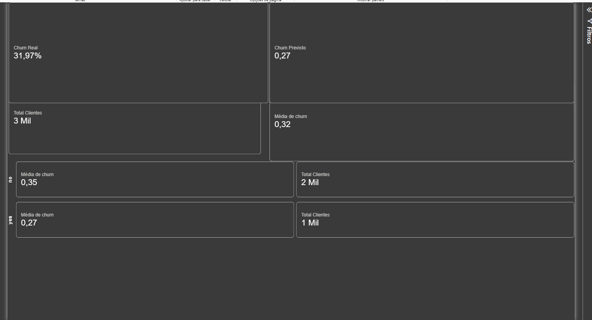

## O problema

Prever churn é um dos casos de uso mais comuns em análise de dados e IA
aplicada a negócio: identificar clientes com risco de cancelamento permite
que a empresa aja antes (desconto, contato, upgrade de plano) em vez de só
reagir depois que o cliente já saiu.

## Arquitetura

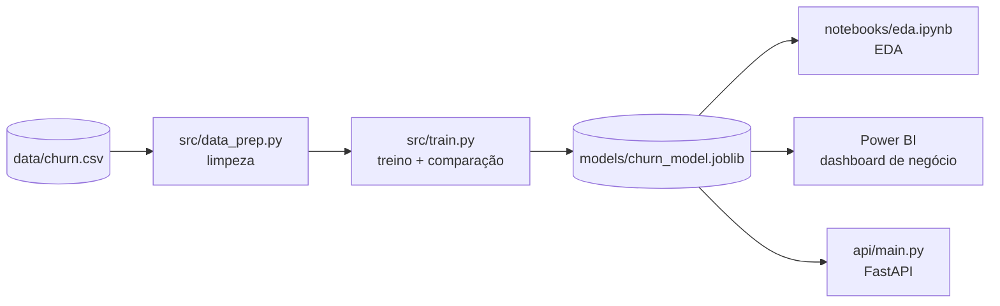

O modelo treinado é o núcleo do projeto: o mesmo artefato (`.joblib`)
alimenta a análise exploratória, o dashboard e a API — sem duplicar lógica
de scoring entre eles (`score_customers()` em
[`src/export_for_bi.py`](src/export_for_bi.py) é reaproveitada tanto pelo
script de exportação quanto pelo endpoint `/generate-report`).

## Tecnologias

`Python` · `pandas` / `numpy` · `scikit-learn` · `FastAPI` + `uvicorn` ·
`pytest` · `Jupyter` (`matplotlib` / `seaborn`) · `Power BI`

## API

Endpoints em [`api/main.py`](api/main.py), com testes automatizados em
[`tests/test_api.py`](tests/test_api.py) e
[`tests/test_api_cases.py`](tests/test_api_cases.py) (perfis de cliente,
entrada inválida, valores limite) — **115 testes no total, 100% passando**:

| Método | Rota              | Descrição                                              |
|--------|-------------------|---------------------------------------------------------|
| GET    | `/health`         | healthcheck                                              |
| POST   | `/predict`        | recebe os dados de 1 cliente, retorna previsão + probabilidade |
| POST   | `/generate-report`| roda o scoring em todos os clientes e atualiza `data/churn_scored.csv` |

```bash
uvicorn api.main:app --reload
# depois, abra http://127.0.0.1:8000/docs
```

## Sobre os dados

O dataset (`data/churn.csv`) é **sintético**, gerado por
[`data/generate_data.py`](data/generate_data.py) com semente fixa
(reprodutível), mas construído para imitar as correlações de um cenário
real de churn de telecom (baseado no conhecido dataset público *Telco
Customer Churn*):

- Contratos mês a mês têm risco de churn muito maior que contratos de 2 anos.
- Falta de suporte técnico e muitas ligações de suporte aumentam o risco.
- Tempo de casa (`tenure_months`) alto reduz o risco.
- O dataset tem valores faltantes e duplicatas propositais, para exercitar
  a etapa de limpeza.

Isso mantém o projeto 100% reprodutível offline, sem depender de download
de um dataset externo. Trocar por um dataset real (ex: Kaggle Telco
Customer Churn) é possível sem mudar o pipeline — só ajustar as colunas em
[`src/data_prep.py`](src/data_prep.py).

## Abordagem de Machine Learning

- **Pré-processamento**: `StandardScaler` nas features numéricas e
  `OneHotEncoder` nas categóricas, dentro de um `ColumnTransformer` (sem
  vazamento de dados entre treino/teste).
- **Modelos comparados**: Regressão Logística, Random Forest e Gradient
  Boosting (`HistGradientBoostingClassifier`), todos dentro de um `Pipeline`
  do scikit-learn, cada um com o seu próprio pré-processador.
- **Métricas**: accuracy, precision, recall, F1 e ROC-AUC — não só
  accuracy, já que o problema é moderadamente desbalanceado (~32% churn).
  Também há ROC-AUC com validação cruzada (5 folds) para checar estabilidade.
- **Seleção do modelo**: o modelo com maior ROC-AUC no conjunto de teste é
  salvo em `models/churn_model.joblib`.
- **Avaliação visual**: `python -m src.evaluate` gera os gráficos abaixo em
  `docs/figures/` e as métricas em `docs/metrics.json`.

### Resultados (dataset sintético atual)

| Modelo              | Accuracy | Precision | Recall | F1   | ROC-AUC (teste) | ROC-AUC (CV 5 folds) |
|----------------------|----------|-----------|--------|------|-----------------|----------------------|
| **Regressão Logística** | 0.758 | 0.639     | 0.563  | 0.598| **0.804**       | 0.822 ± 0.013        |
| Random Forest         | 0.737    | 0.618     | 0.464  | 0.530| 0.781           | 0.805 ± 0.016        |
| Gradient Boosting     | 0.737    | 0.606     | 0.505  | 0.551| 0.780           | 0.809 ± 0.021        |

A Regressão Logística venceu neste caso — sinal de que a relação entre as
features e o churn é majoritariamente linear no dataset gerado (o Gradient
Boosting, mais flexível, não trouxe ganho). Com um dataset real, vale
revisitar essa comparação.

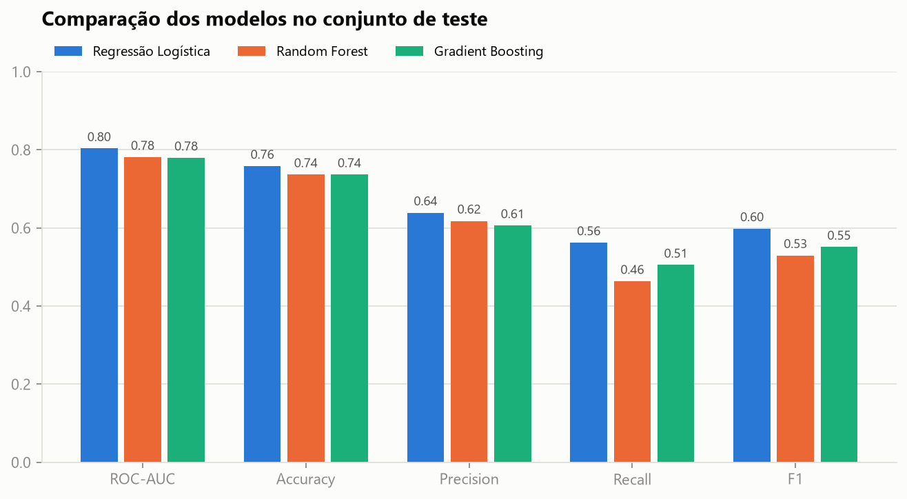

### Para onde o modelo olha

A importância por permutação (queda no ROC-AUC ao embaralhar cada variável)
confirma o que a EDA já mostrava: **tipo de contrato** e **tempo de casa**
dominam; ligações ao suporte vêm em seguida.

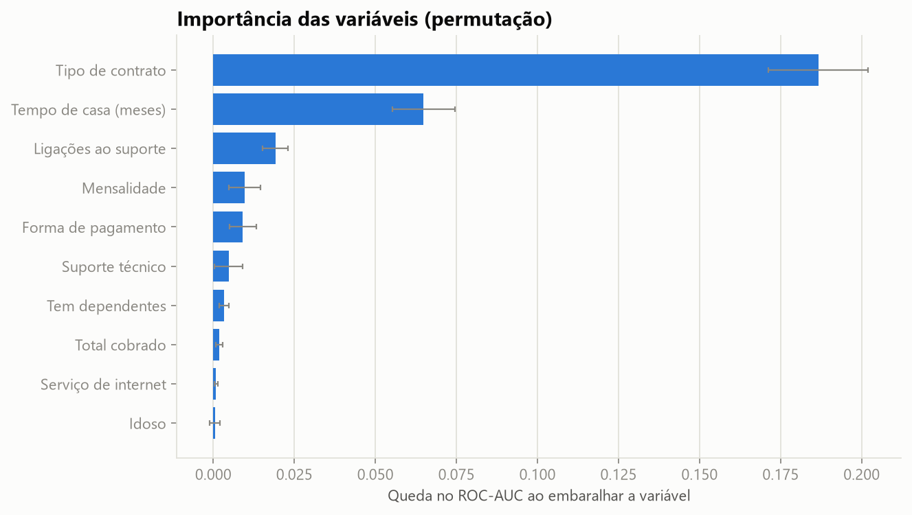

### Limiar de decisão: precisão × recall

Com o limiar padrão (0,50) o modelo deixa passar muitos churns (recall 56%).
Em retenção, perder um cliente costuma custar mais do que fazer uma
abordagem desnecessária, então o limiar foi otimizado para o F1 usando
**validação cruzada só no treino** (sem olhar o teste): **0,32**. Resultado
no teste: recall sobe de 56% para **74%**, ao custo de precisão menor (64% → 54%).

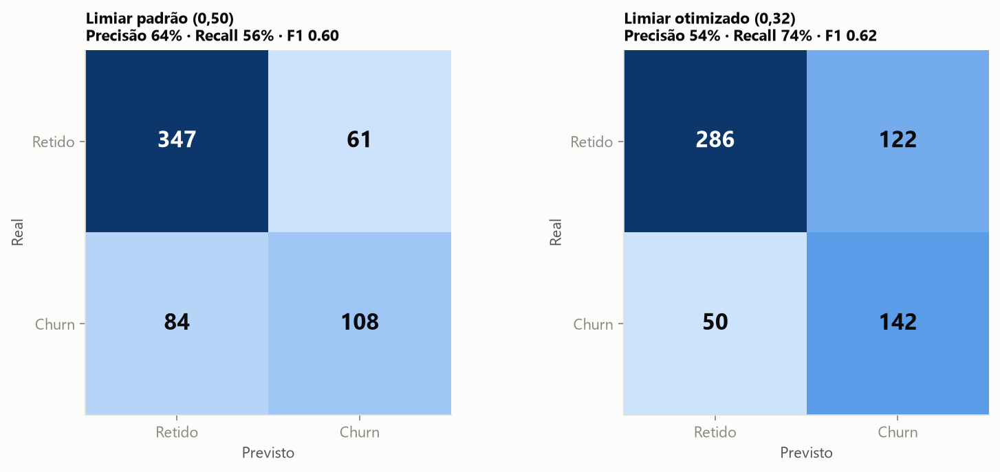
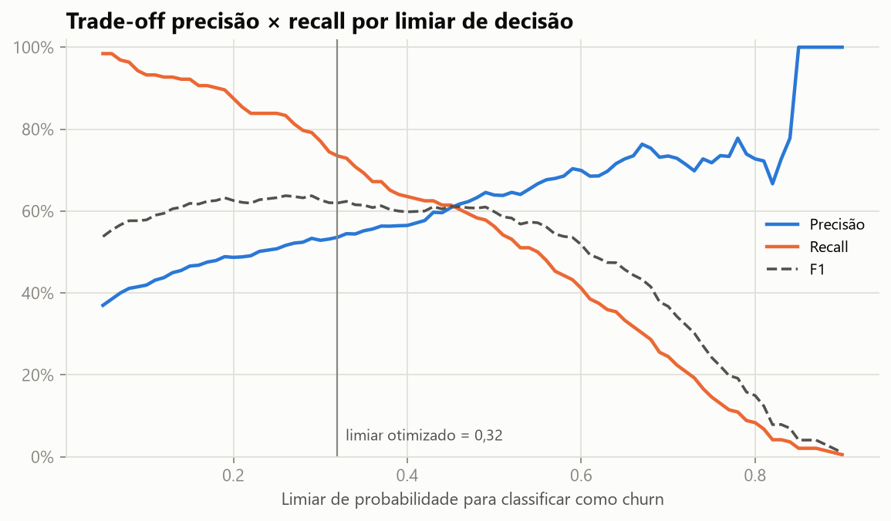

### Curvas ROC, calibração e lift

As probabilidades são razoavelmente calibradas e ordenam bem o risco: os **3 decis de
maior risco concentram 59% de todos os churns** do conjunto de teste
(taxa real de 73% no decil mais arriscado contra 3% no mais seguro).

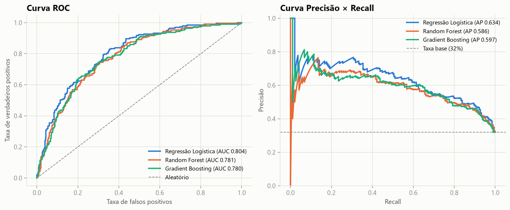
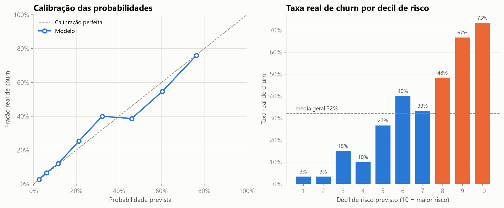
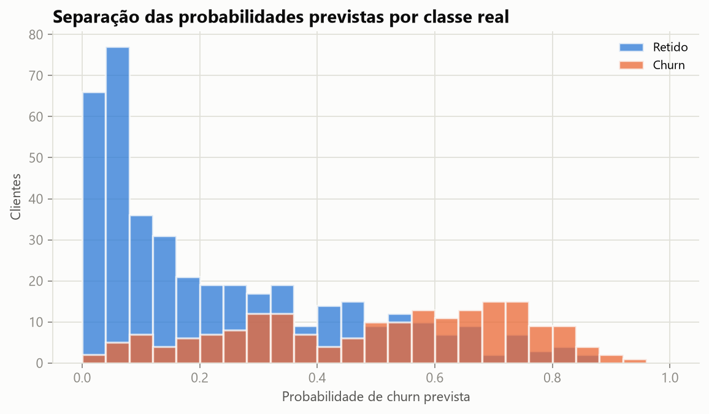

### Casos de uso: do modelo para a decisão

`python -m src.insights` gera gráficos que traduzem o modelo em ações (e
`docs/insights.json` com os números por trás):

**Perfis de cliente** — risco previsto para 7 personas, de "recém-chegado
insatisfeito" (96%) a "cliente fiel" (1%); esses mesmos perfis são usados
como casos de teste da API.

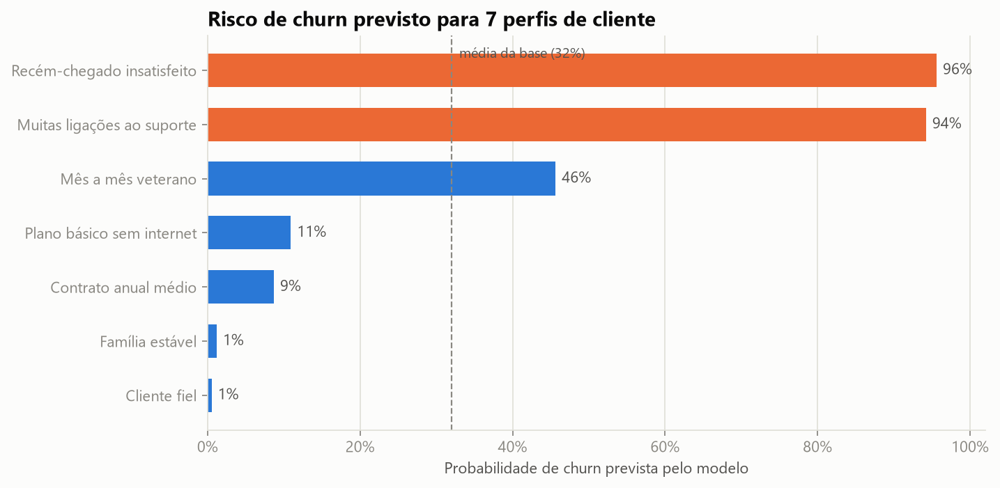

**O que mexe no risco** — razões de chances da Regressão Logística e
cenários "e se?" (mais tempo de casa, mais ligações ao suporte):

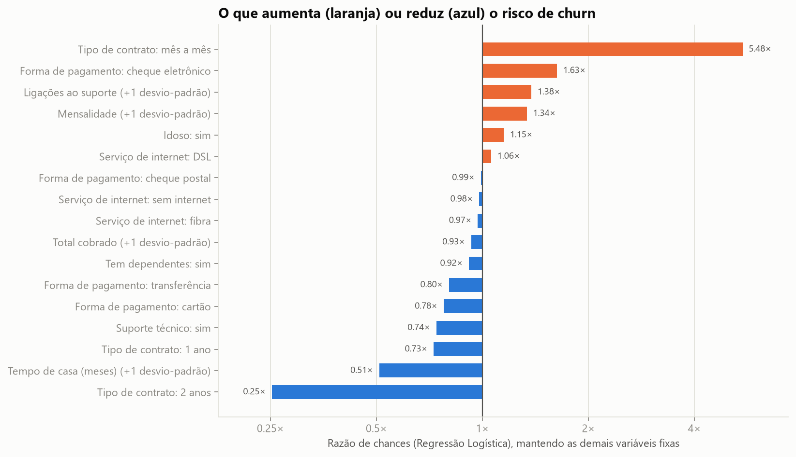
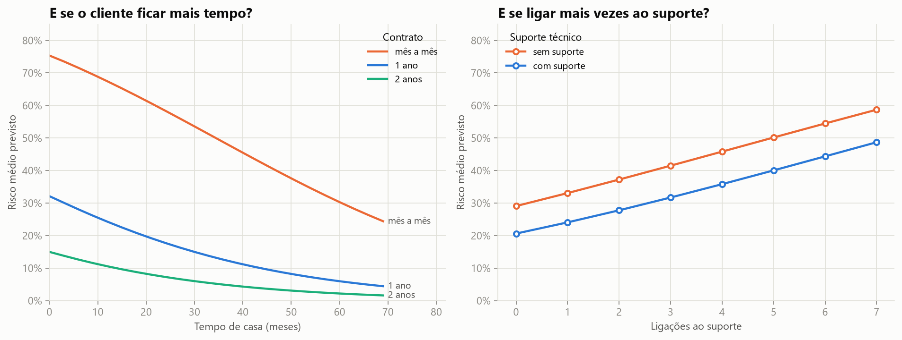

**Retorno de uma campanha** — abordando só os 30% de maior risco já
capturamos 59% dos churns; com premissas *ilustrativas* (R$ 60/contato, 30%
de sucesso, 12 meses preservados) o benefício líquido máximo ocorre ao
abordar ~50% da base:

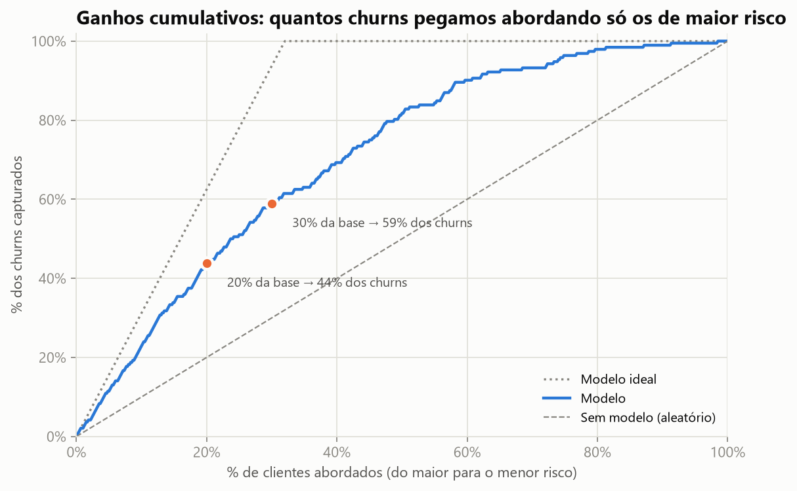
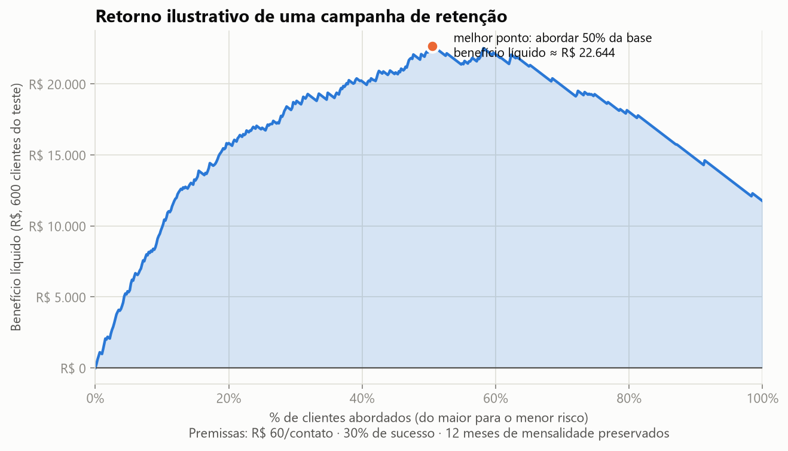

**Robustez** — curva de aprendizado e estabilidade do ROC-AUC (5 folds × 3
repetições): a Regressão Logística é a melhor *e* a mais estável.

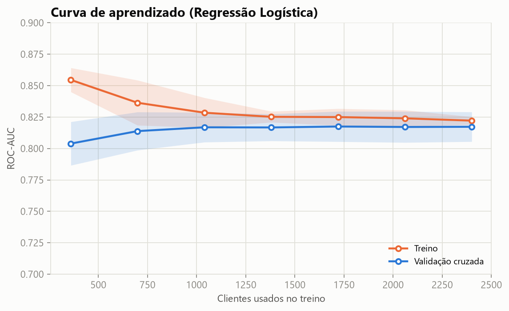
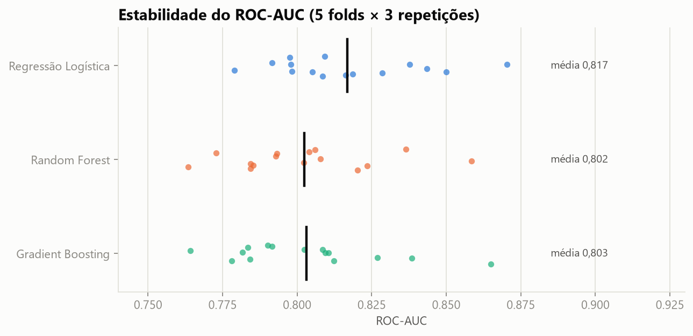

## Análise Exploratória (EDA)

Notebook completo ([`notebooks/eda.ipynb`](notebooks/eda.ipynb), roteiro
original em [`TASK_EDA.md`](TASK_EDA.md)) cobrindo qualidade dos dados,
distribuições, correlações, taxa de churn por segmento, cruzamentos e
receita em risco — com gráficos já renderizados no próprio notebook.

### Principais insights da EDA

1. **Contrato mês a mês concentra o problema**: 48% de churn (1 ano: 15%;
   2 anos: 7%) e 84% da receita mensal perdida.
2. **Os primeiros 12 meses são críticos**: o churn cai de ~49% (0–5 meses)
   para ~19% (60+ meses); mês a mês com menos de 1 ano de casa chega a 70%.
3. **Suporte técnico ajuda, mas menos que o contrato**: 35% sem suporte vs 27%
   com; mês a mês sem suporte é o perfil de maior risco (52%).
4. **Muitas ligações ao suporte são um alerta**: de 24% (nenhuma) a 49% (5+).
5. **Cheque eletrônico** tem churn de 40% vs ~29% em cartão/transferência.

Cerca de **R$ 64,8 mil/mês (33% da receita)** está em clientes que cancelam.

## Dashboard no Power BI

Os dados com a previsão do modelo incluída
(`data/churn_scored.csv`, gerado por `src/export_for_bi.py` ou pelo
endpoint `/generate-report`) alimentam um dashboard de negócio com KPIs,
gráficos por segmento e uma tabela de clientes de maior risco. Roteiro
completo em [`TASK_POWERBI.md`](TASK_POWERBI.md).

## Como rodar

```bash
python -m venv .venv
.venv\Scripts\activate            # Windows
pip install -r requirements.txt

python data/generate_data.py       # gera data/churn.csv
pytest -v                           # roda toda a suite de testes
python -m src.train                  # treina, compara modelos e salva o melhor
python -m src.evaluate                # gera gráficos e métricas em docs/
python -m src.insights                # perfis, cenários, ganhos e retorno de campanha
python -m src.predict data/churn.csv  # exemplo de predição em lote
uvicorn api.main:app --reload          # sobe a API em http://127.0.0.1:8000/docs
```

## Estrutura do projeto

```
data/generate_data.py     # gera o dataset sintético (data/churn.csv)
src/data_prep.py           # limpeza e preparação (funções puras, testáveis)
src/train.py                # treino, comparação de modelos e avaliação
src/predict.py                # inferência em lote com o modelo salvo
src/evaluate.py                  # gráficos e métricas de avaliação (docs/figures)
src/insights.py                  # personas, cenários "e se?", ganhos e ROI de campanha
src/viz.py                         # estilo e paleta compartilhados dos gráficos
src/export_for_bi.py           # gera data/churn_scored.csv (dados + previsão)
api/main.py                      # API (FastAPI): /predict e /generate-report
api/schemas.py                     # contratos de entrada/saída da API
tests/                               # testes automatizados (pipeline + API)
notebooks/eda.ipynb                   # análise exploratória (ver TASK_EDA.md)
models/                                 # modelo treinado (.joblib), local
docs/powerbi_dashboard.png               # print do dashboard (ver TASK_POWERBI.md)
docs/figures/ e docs/metrics.json         # gráficos e métricas geradas por src.evaluate
RELATORIO_MELHORIAS.md                     # relatório das melhorias de gráficos e análises
```

## Status do projeto

- [x] Pipeline de limpeza, features e treino de modelos
- [x] Testes automatizados (pipeline + API)
- [x] API de previsão (FastAPI)
- [x] Notebook de EDA completo, com insights de negócio
- [x] Avaliação visual do modelo (ROC, PR, calibração, lift, limiar, importância)
- [ ] Dashboard Power BI (KPIs principais prontos; receita em risco e tabela de risco pendentes)
- [ ] Dataset real (Kaggle Telco Customer Churn) no lugar do sintético

## Próximos passos possíveis

- Terminar o dashboard do Power BI (receita em risco + tabela de clientes de risco).
- Trocar o dataset sintético pelo Telco Customer Churn real do Kaggle.
- Adicionar tuning de hiperparâmetros (`GridSearchCV`/`RandomizedSearchCV`).
- Usar o limiar otimizado (0,32) também na API/`churn_scored.csv`.
- Containerizar a API com Docker.
